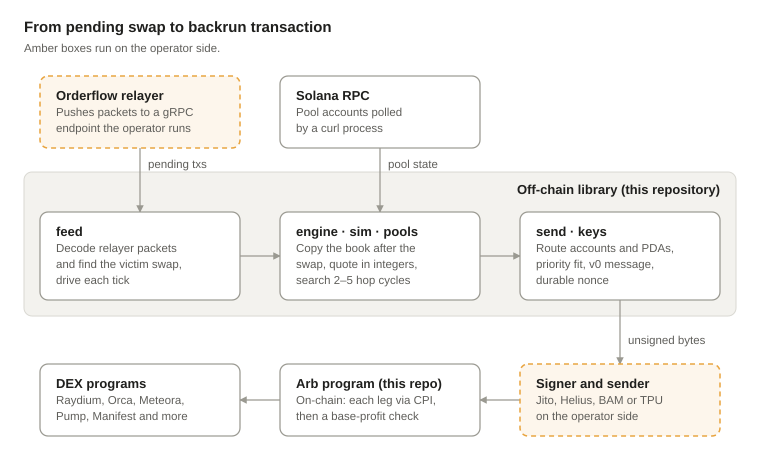

# Mriya3 — Technical Analysis

October 18, 2026

## Executive summary

Mriya3 is a carefully engineered Solana backrun bot. Its pricing math, route encoding and on-chain executor are solid.

- **What it is.** An atomic 2–5 hop cyclic arbitrage that backruns a user's swap read before execution. Rust, about 16,300 lines, modelled on the mainnet wallet `MriyaNN8…` down to its instruction format.
- **Strengths.** Exact integer quoting with mostly conservative rounding; 27 venue encoders in the on-chain program; the Agave scheduler priority model reproduced to the unit; 261 tests (253 host tests, all passing, plus 8 SBF tests), many on real mainnet account snapshots; a small dependency surface and no malicious code found.

## Strategy and scope

Mriya3 is an atomic cyclic-arbitrage backrunner for Solana mainnet. It reads a user's signed swap before execution, prices the pools as they will be after that swap, and builds a 2–5 hop arbitrage meant to land right behind it. It is not a sandwich: the code never places a transaction before the user's (`feed/src/pending.rs:6`).

- **Chain and base.** Solana mainnet. The cycle starts and ends in WSOL by default; a stablecoin base works with a configured SOL price (`feed/src/run.rs:300-309`).
- **Origin.** Code comments say the instruction layout, venue codes and discriminators were reverse-engineered from a reference bot (disassembly plus a window of transactions dated 2026-09-26); a test pins that bot's wallet, `MriyaNN8TMp6qRWjfr723PK7xgQK7yCt7Kg2v2PQu7X`. It is a format-level clone of that bot, not an original design.
- **Orderflow assumption.** Pending transactions arrive as Jito-style `PacketBatchUpdate` messages, pushed by a private-orderflow relayer (see Contact) to a block-engine endpoint the operator runs (`feed/src/pending.rs:1-11`).
- **Placement.** On the backrun path the bot sets its scheduler priority to the victim's minus one, pays no tip, and relies on the Agave scheduler to order the two transactions (`feed/src/run.rs:177-192`).
- **Codebase.** Rust, about 16,300 lines in 8 workspace crates plus an SBF program, a mock DEX and a test client. MIT licence, no commit history.

| Venue | Priced by the search | Victim swap decoded | Main limitation |
| --- | --- | --- | --- |
| Raydium CLMM, Pancake, Byreal | Yes, single price range | Yes (exact-in) | No tick crossing in the production wiring |
| Orca Whirlpool | Yes, single price range | Yes (exact-in) | No tick-array decoder |
| Meteora DLMM | Yes, active bin array only (≤ 70 bins) | No | Base fee only, no variable fee |
| Raydium CPMM | Yes, constant product | Yes (exact-in) | Fee taken from config, not the pool |
| Pump AMM | Yes, constant product | Yes (sell, buy exact quote) | Creator and tiered fees not modelled |
| Meteora DAMM v2 | Yes, as constant product | No | Likely mis-modelled: it is a sqrt-price pool |
| Meteora DAMM v1 | Yes, constant product from LP share | No | Fee from config |
| Raydium AMM v4 | Yes, constant product | No | Fee from config |
| Manifest | Yes, order book (≤ 128 levels) | Yes (exact-in) | Stops at global orders |
| Pump.fun, LaunchLab, Futarchy, DFlow, GoonFi, Orca token-swap, Saros, Hylo, BSwp, AlphaQ, Meteora DBC, SwaPpA9L | No, encode only | No | The program can call them, the search never picks them |

## Architecture

The library turns a decoded pending swap into a ready-to-sign backrun transaction. Of about 16,300 lines, `feed` (6,800) and `send` (3,600) are the largest; the pricing core (`sim`, `pools`, `engine`) is about 3,000 and the on-chain program about 1,650.

## Detection and execution pipeline

One relayer message becomes zero or more unsigned v0 transactions in a single synchronous call chain starting at `Runner::tick_backrun_update` (`feed/src/run.rs:277`).

1. **Decode the relayer batch.** A hand-written protobuf parser reads the `PacketBatchUpdate`, trims each packet to `meta.size`, and flags votes and discarded packets, which the runner then skips (`feed/src/relayer.rs:38`, `feed/src/run.rs:263`).
2. **Decode the transaction.** Legacy, v0 and v1 (SIMD-0385) formats are parsed (`feed/src/pending.rs:161`). Accounts loaded through address lookup tables are not resolved.
3. **Find the victim swap.** Only top-level instructions on pools already in the registry are read (`feed/src/pending.rs:424-504`). Swaps routed through an aggregator such as Jupiter are CPIs, so they are invisible.
4. **Apply the swap.** The whole engine is cloned and the victim swap is applied with the same pricing models (`engine/src/lib.rs:297-315`).
5. **Search.** Best 2-hop (all pool pairs), best 3-hop (all pool triples) and 4–5 hop cycles by DFS capped at 20,000 evaluations per cycle length. A longer cycle wins only if strictly more profitable (`feed/src/run.rs:197-222`). The search is global: it is not anchored on the pool the victim touched.
6. **Size the trade.** Integer ternary search over input size, roughly 60 iterations per candidate route (`sim/src/opt.rs:12-35`).
7. **Price the slot.** The target is the victim's Agave scheduler priority minus one. The bot solves for a CU limit and CU price that hit it exactly (`send/src/lib.rs:177-207`). Victims without a `SetComputeUnitLimit` instruction are skipped.
8. **Build the message.** Route accounts are assembled, intermediate token accounts are created idempotently, and the v0 message is compiled twice (probe, then final), optionally with a durable nonce (`feed/src/run.rs:312-489`).
9. **Return bytes.** The output is a `SignablePackage`: unsigned message bytes plus metadata. Signing and sending stay with the operator.

Pool state comes from the caller: the backrun entry point takes a ready `Engine`. On the plain-arbitrage path, `poll_once` fetches every registry account in one `getMultipleAccounts` call, made by spawning a `curl` process (`feed/src/transport.rs:105-136`). The repository has no benchmarks; a full engine clone plus an exhaustive search per packet will slow down quickly as the pool registry grows, and this needs measuring.

## On-chain program

The executor is a small native `solana_program` 2 program, not Anchor: about 140 lines of entrypoint (`program-sbf/src/lib.rs`) over a `no_std` core holding the route parser, 27 venue CPI encoders and the profit check (`program/src/`). It holds no funds and never signs for the bot: every leg is a plain `invoke`, with the bot as signer.

- **Instructions.** `0x00` Initialize creates a state PDA `["state", bump]` that stores the authority. `0x0a` Execute runs a route.
- **Execute data.** 97 + 5n bytes for n = 2–6 legs: amount in, minimum profit B, SOL price, leg count, nonce, a 32-byte K field, 5 bytes per leg (venue, direction, account count, token-account size), a trailer, and a 30-byte `MRXP` tag the program never reads (`program/src/lib.rs:120-212`).
- **Authorisation.** Account 0 must sign (else `MissingRequiredSignature`), and the state account must be owned by the program, initialised and name that signer (else `Custom(6902)`) (`program-sbf/src/lib.rs:97-106`).
- **Legs.** Leg 1 swaps `amount_in`. Every later leg swaps the full balance of the intermediate token account. Per-leg minimum output is 1 for Pump AMM and Pump.fun and 0 elsewhere, so the end-of-route check is the only guard.
- **Profit gate.** Base-token balance after versus before. No gain returns `Custom(0)`; a gain at or below B (in lamports) returns `Custom(profit/1000)` (`program/src/lib.rs:226-238`).

| Finding | Effect | Severity |
| --- | --- | --- |
| The gate measures the base token account only, not the SOL spent on fees, and the backrun path sets B = 0 | A route can land and still lose money once fees are counted | Medium |
| A positive profit under 1,000 lamports that misses B also returns `Custom(0)`; `profit/1000` can equal 6901 or 6902; the cast to u32 truncates | Error codes are ambiguous for monitoring | Low |
| No allow-list of DEX program IDs, no owner or mint checks on token accounts | A wrong or malicious program ID in the route config receives the bot's signer privilege; outsiders cannot inject one into the operator's transaction | Medium |
| Initialize accepts any valid bump and does not check the upgrade authority | Anyone can create their own state PDA and use the program, or take the canonical address first after deploy | Low |
| SBF tests load prebuilt `.so` files that are checked in | They cannot be tied to the source and should be rebuilt | Info |

## Infrastructure and submission

Each transaction is prepared for one of several submission lanes. The lane comes from the configuration and the path (backrun or plain arbitrage) and is recorded in a LANE byte of the route metadata, which the program does not read.

| Lane | What the code builds |
| --- | --- |
| 1 – Backrun | Priority = victim − 1, no tip, B = 0 |
| 2 – Tip auction | Tip = a configured share of predicted gross (34.1% observed on the reference bot), rounded half-up, as a System transfer to a caller-supplied tip account; CU price 0 (`send/src/lib.rs:94-106`) |
| 4 – Helius Sender | Same tip, CU price 0 |
| 5 – Harmonic, 6 – BAM | The same bid paid as an exact priority fee |
| Direct TPU | Parses `getLeaderSchedule` and `getClusterNodes`; sending goes through a pluggable TpuSender (`feed/src/tpu.rs:107-124`) |

The backrun path uses lane 1; lanes 2, 4, 5 and 6 serve the plain-arbitrage path (`tick()`).

- **Transaction size.** Nothing checks the 1,232-byte packet limit, and account indexes are cast to u8 without a check (`send/src/tx.rs:412-420`). A Pump AMM + DLMM two-leg route has 56 route account entries, about 40 unique keys (around 1.25 KB of keys alone), so with the signature and instruction data it cannot fit without lookup tables.
- **Lookup tables.** Supported only for tables the caller supplies; nothing fetches, creates or extends them, and none are used unless the caller passes them (`feed/src/run.rs:77-80`).
- **Durable nonce.** 1,000 derived nonce accounts, used as 500 pairs; only the even account of a pair enters a transaction. The nonce value is computed locally from a blockhash, so the operator must track each account's last advance; the pool counter never moves (`feed/src/run.rs:81-84`).
- **Compute budget.** The configured CU limit (127,000 in tests) is a floor: the backrun path and lanes 5–6 raise it to hit their target. It is never taken from simulation. Instruction order copies the reference bot's on-chain fingerprint.
- **State feed.** One `curl` process per JSON-RPC call with a 30 s timeout. All registry accounts go into one `getMultipleAccounts` call; the standard Solana RPC caps that at 100 keys and the request is not split. DLMM active bin and CLMM current tick are static snapshots in the pool specs that nothing refreshes.
- **Priority − 1.** It mirrors the Agave cost model to the unit (`send/src/lib.rs:120-167`). It orders the two transactions only when both reach the same leader's scheduler and share a write lock; Firedancer-based leaders schedule differently (unverified).

## Contact

For the relayer (private mempool) and other MEV services, please contact [@parallel_DEV](https://t.me/parallel_DEV) on Telegram.
